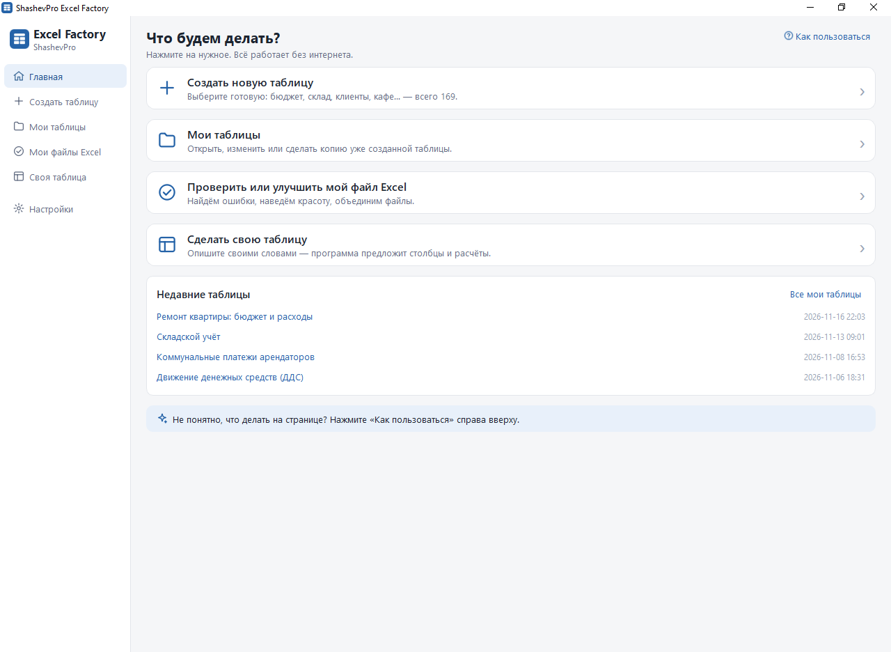
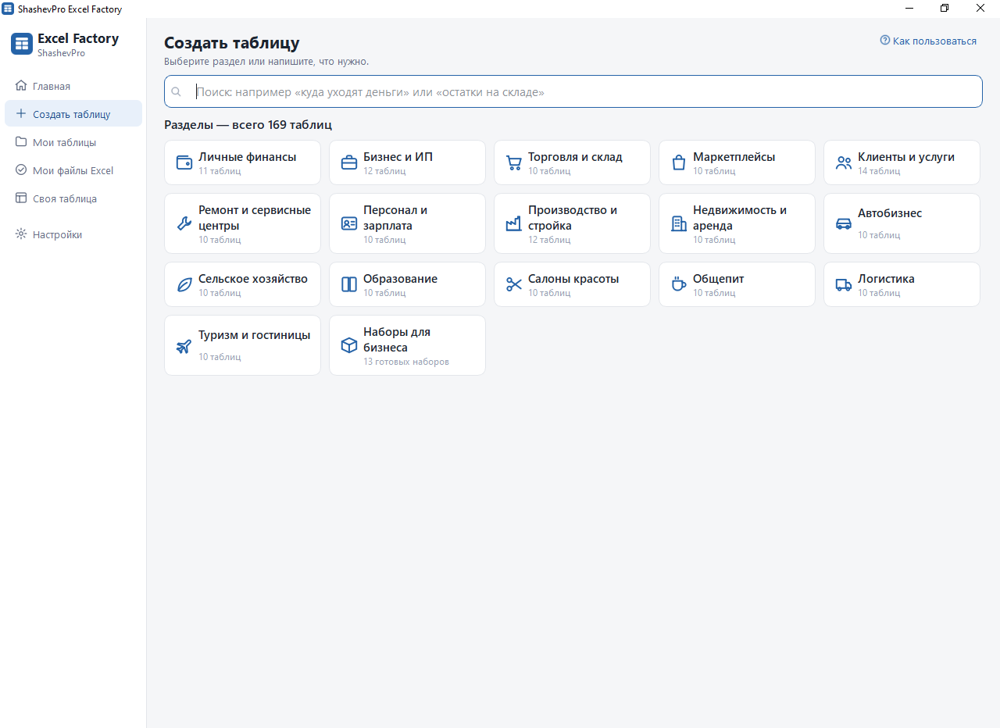
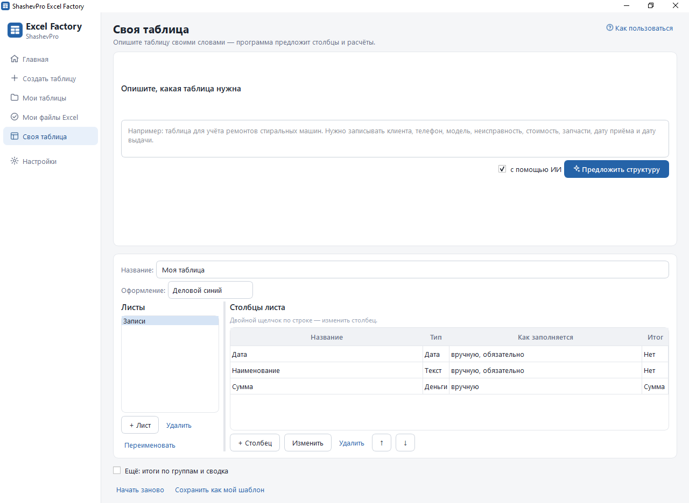

# Excel Factory

**Профессиональный генератор таблиц Excel для Windows**

**Excel Factory 1.4** — коммерческая программа ShashevPro для создания таблиц Excel по готовым шаблонам, разработки собственных таблиц и работы с существующими XLSX-файлами. Понятный русскоязычный интерфейс, пошаговые действия и автоматизация расчётов.

**[Купить Excel Factory на Kwork](https://kwork.ru/software/55517082/excel-factory-professionalniy-generator-tablits-excel)** · **[Сайт разработчика ShashevPro](https://www.shashevpro.ru/)**

> **Официальная страница коммерческого продукта.** На GitHub представлены описание и реальные скриншоты интерфейса. **Исходный код, установщик и шаблоны полной версии не публикуются.**

---

## Посмотрите, как выглядит программа

*Ниже — настоящие скриншоты Excel Factory 1.4, а не рекламные макеты.*

### 1. Главный экран — всё необходимое под рукой

На главной странице можно выбрать готовую таблицу, открыть свои проекты, проверить или улучшить файл Excel либо перейти к собственному конструктору.

### 2. Каталог шаблонов — 169 готовых таблиц

Поиск помогает найти подходящее решение. В каталоге представлены **169 таблиц в 16 тематических разделах**, а также **13 наборов для бизнеса**.

### 3. «Своя таблица» — конструктор под вашу задачу

Опишите задачу своими словами или настройте вручную листы, столбцы и расчёты. ИИ-функции доступны отдельно при подключении собственного ключа DeepSeek API; базовая работа не требует ИИ.

---

## Возможности Excel Factory

| Функция | Что можно сделать |
| --- | --- |
| **169 шаблонов / 16 разделов** | Подготовить таблицу для финансов, бизнеса, склада, персонала, услуг и других задач |
| **Мастер создания** | Заполнить понятные поля и получить Excel-файл с формулами и оформлением |
| **Конструктор таблиц** | Собрать структуру из листов, столбцов, списков, итогов, формул и отчётов |
| **Проверка файлов Excel** | Найти ошибки в формулах и данных, дубли, проблемные даты и другие несоответствия |
| **Улучшение таблиц** | Добавить оформление, фильтры, итоги, диаграммы и параметры печати |
| **Объединение и сравнение** | Работать с данными из нескольких XLSX-файлов и сопоставлять версии |
| **13 бизнес-наборов** | Получить комплект связанных таблиц для определённой сферы деятельности |
| **ИИ-помощник (опционально)** | Подсказки по структуре и формулам через DeepSeek API при отдельном подключении |

### Примеры направлений

Личные финансы · Бизнес и ИП · Торговля и склад · Маркетплейсы · Клиенты и услуги · Ремонт · Персонал и зарплата · Производство и стройка · Недвижимость · Автобизнес · Сельское хозяйство · Образование · Салоны красоты · Общепит · Логистика · Туризм и гостиницы.

## Как начать работу после покупки

1. Получите дистрибутив программы у продавца после оформления заказа.
2. Установите Excel Factory на компьютер с Windows.
3. На главной странице нажмите **«Создать новую таблицу»**, чтобы открыть каталог, или **«Сделать свою таблицу»**, чтобы перейти в конструктор.
4. Выберите шаблон и пройдите пошаговый мастер или самостоятельно настройте будущую таблицу.
5. Сохраните получившийся XLSX-файл и откройте его в совместимом табличном редакторе.

Основные возможности Excel Factory работают **без подключения к интернету**. Для ИИ-помощника нужен интернет и собственный ключ DeepSeek API. Для просмотра созданных книг нужен Microsoft Excel или совместимый редактор, например LibreOffice Calc.

## Покупка, поддержка и сведения о продукте

- **Купить полную версию:** [Excel Factory на Kwork](https://kwork.ru/software/55517082/excel-factory-professionalniy-generator-tablits-excel)
- **Разработчик и официальный сайт:** [ShashevPro](https://www.shashevpro.ru/)
- **Ответы на вопросы:** [SUPPORT.md](SUPPORT.md)
- **История изменений:** [CHANGELOG.md](CHANGELOG.md)
- **Коммерческие права:** [COPYRIGHT.md](COPYRIGHT.md)

**Версия:** 1.4 · **Платформа:** Windows · **Продукт:** коммерческое ПО

© 2026 ShashevPro. Все права защищены.
